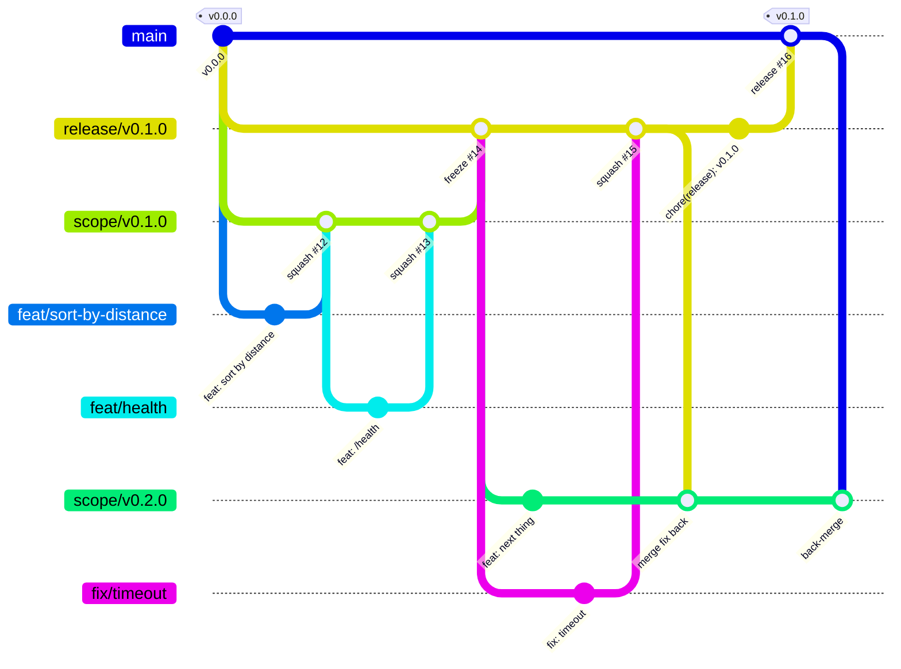

# Release manager guide

How code moves from a feature branch to a tagged release, and what the release manager does at each step.

> [!NOTE]
> **Status: planned, not adopted yet.** The CI and ruleset changes this flow needs are listed in [What has to change before adopting](#what-has-to-change-before-adopting). Until then, the repo uses plain pull requests into `main`.

---

## The flow at a glance

```
feat/*, fix/* ──PR──▶ scope/vX.Y.Z ──PR (freeze)──▶ release/vX.Y.Z ──PR──▶ main ──▶ tag vX.Y.Z
                          ▲                               │
                          └──────── merge back fixes ─────┘
```



| Branch            | Created from                      | Merges into       | Lifetime                | Who may push                            |
| ----------------- | --------------------------------- | ----------------- | ----------------------- | --------------------------------------- |
| `main`            | —                                 | — (only receives) | permanent               | nobody directly; release and hotfix PRs |
| `scope/vX.Y.Z`    | `main` (or the previous release¹) | `release/vX.Y.Z`  | one version, ~1–3 weeks | nobody directly; feature PRs            |
| `release/vX.Y.Z`  | `main`                            | `main`            | until tagged, ~days     | nobody directly; freeze and fix PRs     |
| `feat/…`, `fix/…` | `scope/vX.Y.Z`                    | `scope/vX.Y.Z`    | hours to a few days     | the author                              |
| `fix/…` (freeze)  | `release/vX.Y.Z`                  | `release/vX.Y.Z`  | hours                   | the author                              |
| `hotfix/vX.Y.Z`   | `main` at the latest tag          | `main`            | hours                   | the author                              |

¹ See [Working on the next version during a freeze](#working-on-the-next-version-during-a-freeze).

---

## What we borrowed, and from where

No single published model matches this flow exactly. Each part below is taken from a model that has been used at scale, and the rejected parts are listed too.

| Idea                                                                                    | Source                                                                                                            | How it shows up here                                                                                                                                                            |
| --------------------------------------------------------------------------------------- | ----------------------------------------------------------------------------------------------------------------- | ------------------------------------------------------------------------------------------------------------------------------------------------------------------------------- |
| A temporary integration branch per release, release branches, merge-back, tag on `main` | [Git Flow](https://nvie.com/posts/a-successful-git-branching-model/) (Vincent Driessen, 2010)                     | `scope/vX.Y.Z` plays the role of Git Flow's `develop`, but one per version instead of permanent. `release/*` merges to `main`, `main` is tagged, fixes are merged back.         |
| Code freeze, then only fixes on the release branch, with a named release manager        | [Kubernetes release cycle](https://kubernetes.io/releases/release/)                                               | Merging scope into release is the freeze. After it, only `fix:` PRs enter `release/*`, and the release manager approves them.                                                   |
| Only release managers create release branches; nobody pushes to protected branches      | [Microsoft Release Flow](https://learn.microsoft.com/en-us/devops/develop/how-microsoft-develops-devops)          | GitHub rulesets: `release/**` creation restricted to the release manager, and every protected branch requires a PR.                                                             |
| Fix where the code will live next, or the bug comes back in the next version            | Microsoft Release Flow, [trunk-based "branch for release"](https://trunkbaseddevelopment.com/branch-for-release/) | Every fix made on `release/*` is merged back into the open `scope/*` the same day. This is the one step most often forgotten, so it is on the checklist.                        |
| Short-lived branches, small PRs, delete after merge                                     | [GitHub flow](https://docs.github.com/en/get-started/using-github/github-flow)                                    | Feature branches live hours to days and are deleted on merge. Scopes are kept small, so a `scope/*` branch is not long-lived either.                                            |
| Branches as stages that code flows down through, each tested                            | [GitLab Flow](https://about.gitlab.com/topics/version-control/what-is-gitlab-flow/)                               | scope → release → main is a one-way pipeline. Each stage re-runs CI on the merged result, and the release stage adds the checks that are too slow or too external for every PR. |

**What we did not take, and why:**

- **A permanent `develop` branch (Git Flow).** It drifts away from `main` and collects merge debt. Driessen's own [2020 note](https://nvie.com/posts/a-successful-git-branching-model/) says Git Flow is for software "explicitly versioned" or with "multiple versions in the wild", and recommends GitHub flow for continuously delivered services. A per-version `scope/*` that is deleted after release keeps the versioning without the permanent drift.
- **Fix on main first, then cherry-pick to the release (Microsoft, trunk-based).** That works when `main` is the integration branch. Here `main` only holds released code, so fixes flow downstream instead (release → main) and are merged back up (main → open scope). The risk is the same, a forgotten fix that returns later, and the [back-merge step](#5-ship-merge-to-main-and-tag) covers it.
- **Several supported release lines (Kubernetes keeps ~12 months of patches).** One deployed service needs one line. Old `release/*` branches are deleted after tagging, and a hotfix starts from the latest tag.

### When this flow is too heavy

This is a release-train model: it pays off when a version is a promise (to QA, to clients, to a release note) and several people work in parallel. For one or two people shipping a single service, plain GitHub flow (PR into `main`, deploy, tag) has fewer steps and fewer places for a fix to get lost. If scopes routinely hold a single feature, or the freeze stage never finds anything, switch back.

---

## Naming

| Thing          | Pattern                                    | Example                          |
| -------------- | ------------------------------------------ | -------------------------------- |
| Scope branch   | `scope/v<MAJOR>.<MINOR>.<PATCH>`           | `scope/v0.1.0`                   |
| Release branch | `release/v<MAJOR>.<MINOR>.<PATCH>`         | `release/v0.1.0`                 |
| Work branch    | `<type>/<short-kebab-summary>`             | `feat/sort-by-distance`          |
| Hotfix branch  | `hotfix/v<MAJOR>.<MINOR>.<PATCH>`          | `hotfix/v0.1.1`                  |
| Tag            | `v<MAJOR>.<MINOR>.<PATCH>`, annotated      | `v0.1.0`                         |
| PR title       | Conventional Commit, it becomes the squash | `feat(routes): sort by distance` |

- **`<type>`** is the Conventional Commit type the work will be squashed as: `feat`, `fix`, `refactor`, `docs`, `test`, `ci`, `chore`, `perf`. commitlint (`commitlint.config.mjs`) already enforces these on commit messages.
- **Versions follow [SemVer](https://semver.org/).** While the major is `0`, the API may change in any minor. From `1.0.0` on, a breaking change (`feat!:` or a `BREAKING CHANGE:` footer) means a new major. Conventional Commits makes the next version mechanical:
  - any breaking change → major (minor while on `0.x`)
  - any `feat` → minor
  - only `fix`/`perf` → patch

---

## Merge methods

| PR                              | Method           | Why                                                                                                                           |
| ------------------------------- | ---------------- | ----------------------------------------------------------------------------------------------------------------------------- |
| work branch → `scope/*`         | **Squash**       | One Conventional Commit per feature or fix, so the history and changelog read as a list of changes, not of "wip" commits.     |
| work branch → `release/*`       | **Squash**       | Same.                                                                                                                         |
| `scope/*` → `release/*`         | **Merge commit** | Keeps each feature's squashed commit. Squashing here would collapse the whole version into one commit and lose the changelog. |
| `release/*` → `main`            | **Merge commit** | Same, and the merge commit is what gets tagged.                                                                               |
| `main` → `scope/*` (back-merge) | **Merge commit** | Brings release fixes up without rewriting either branch.                                                                      |

Rebase-and-merge is not used: it rewrites commit SHAs, so the branches' histories stop sharing commits, and back-merges then conflict on changes that are already present.

---

## The release cycle, step by step

### 1. Open the scope

The release manager decides the version number and what goes in (a GitHub milestone named `v0.1.0` holds the list).

```sh
git switch main && git pull
git switch -c scope/v0.1.0 && git push -u origin scope/v0.1.0
git switch main
git switch -c release/v0.1.0 && git push -u origin release/v0.1.0
```

`release/v0.1.0` is created now, from `main`, so it exists as a PR target later. It stays identical to `main` until the freeze.

### 2. Develop

Each change is a short-lived branch from the scope:

```sh
git switch scope/v0.1.0 && git pull
git switch -c feat/sort-by-distance
# … commit, push …
gh pr create --base scope/v0.1.0 --title "feat(routes): sort by distance on equal duration"
```

- CI runs on every PR. The `CI passed` check must be green to merge.
- Keep PRs small. A scope that collects weeks of work becomes a merge-debt problem at freeze time.
- Delete the branch after merging (GitHub can do this automatically: _Settings → General → Automatically delete head branches_).

### 3. Freeze: merge scope into release

When everything in the milestone is merged (or deliberately moved to the next version), the release manager opens the freeze PR:

```sh
gh pr create --base release/v0.1.0 --head scope/v0.1.0 --title "release: freeze v0.1.0"
```

This PR runs the **full gate**: the normal CI jobs plus the release-only checks (the live OSRM integration test today). Merge it with a **merge commit**.

From this point on, `release/v0.1.0` takes **fixes only**. No new features, no refactors, no dependency bumps unless they fix a bug found in this release.

### 4. Stabilise

A bug found during the freeze is fixed on a branch from the release:

```sh
git switch release/v0.1.0 && git pull
git switch -c fix/timeout-on-retry
gh pr create --base release/v0.1.0 --title "fix(osrm): do not retry after the deadline"
```

After it merges, **merge it back into the open scope the same day** (see step 5's back-merge, same commands with `release/v0.1.0` as the source). Waiting until the release ships risks a forgotten fix that reappears in the next version.

Finally, bump the version on the release branch:

```sh
git switch -c chore/release-v0.1.0 release/v0.1.0
pnpm version 0.1.0 --no-git-tag-version   # package.json only; the tag is made on main
git commit -am "chore(release): v0.1.0"
gh pr create --base release/v0.1.0 --title "chore(release): v0.1.0"
```

`package.json`'s version also feeds the OpenAPI `info.version`, so the docs show the new number automatically.

### 5. Ship: merge to main and tag

Go/no-go: the release manager checks the [checklist](#release-checklist), then:

```sh
gh pr create --base main --head release/v0.1.0 --title "release: v0.1.0"
# after CI passes, merge with a merge commit, then:
git switch main && git pull
git tag -a v0.1.0 -m "v0.1.0"
git push origin v0.1.0
gh release create v0.1.0 --generate-notes --verify-tag
```

**Back-merge** `main` into every open `scope/*` so the release's fixes and version bump are in the next version:

```sh
git switch scope/v0.2.0 && git pull
git switch -c chore/back-merge-v0.1.0
git merge --no-ff origin/main -m "chore: merge v0.1.0 back into scope/v0.2.0"
gh pr create --base scope/v0.2.0 --title "chore: merge v0.1.0 back into scope/v0.2.0"
```

Then delete `scope/v0.1.0` and `release/v0.1.0`. The tag keeps the released commit; nothing is lost.

### Working on the next version during a freeze

Work does not have to stop while `release/v0.1.0` stabilises. Open `scope/v0.2.0` from `release/v0.1.0` right after the freeze PR merges. It then already contains everything in 0.1.0, and each stabilisation fix is merged back into it (step 4). When 0.1.0 ships, the back-merge from `main` is a small one.

### Hotfix: a bug in production

```sh
git switch -c hotfix/v0.1.1 v0.1.0          # from the tag, not from a scope
# … fix, bump package.json to 0.1.1, commit as fix: and chore(release): …
gh pr create --base main --title "fix: <what broke>"
# merge, then tag v0.1.1 on main and back-merge main into every open scope/*
```

A hotfix skips scope and release on purpose: it must not carry unreleased work. It still goes through a PR and the full gate.

---

## Release checklist

Copy into the freeze PR description and tick as you go.

```md
### Freeze (scope → release)

- [ ] Every PR in the `vX.Y.Z` milestone is merged or moved to the next milestone
- [ ] Freeze PR is green, including the release-only checks
- [ ] Merged with a **merge commit**

### Stabilise

- [ ] Every fix merged into `release/vX.Y.Z` is also merged back into the open `scope/*`
- [ ] `package.json` version bumped in a `chore(release): vX.Y.Z` commit
- [ ] README / OpenAPI updated for any behaviour change

### Ship

- [ ] Release → main PR green, merged with a **merge commit**
- [ ] Annotated tag `vX.Y.Z` pushed from `main`
- [ ] GitHub release created (`gh release create vX.Y.Z --generate-notes --verify-tag`)
- [ ] `main` merged back into every open `scope/*`
- [ ] `scope/vX.Y.Z` and `release/vX.Y.Z` deleted
- [ ] Milestone closed
```

---

## Who is the release manager

One person per version, named when the scope opens. On a small team, rotate it. The role is coordination, not gatekeeping:

- opens and closes the scope and the milestone
- decides what is in, what slips to the next version, and when to freeze
- approves PRs into `release/*` after the freeze (Kubernetes: cherry-picks into a release branch need a release manager's approval)
- makes the go/no-go call, merges to `main`, tags, and does the back-merges
- is the only one who can create `release/**` branches (Microsoft: only release managers can create branches under `releases/`)

---

## What has to change before adopting

The repo is not set up for this flow yet. When it is adopted:

1. **CI triggers** (`.github/workflows/ci.yml`): add `scope/**` and `release/**` to the `push` branches. PRs into any branch already run CI.
2. **Release-only gate:** run the live OSRM test (`pnpm test:integration`, today in `integration.yml`) on PRs whose base is `release/**` or `main`, and add it to `CI passed`'s `needs` for those PRs. Every PR into these branches is a freeze, fix or release PR, so the shared demo server's rate limit is not a concern.
3. **Rulesets** (_Settings → Rules → Rulesets_):
   - `main`: require a PR and `CI passed` (already set up).
   - `release/**`: the same, plus _Restrict creations_ with the release manager on the bypass list.
   - `scope/**`: require a PR and `CI passed`; _Block force pushes_; _Restrict deletions_.
4. **Merge methods:** allow squash and merge commits, disallow rebase (_Settings → General → Pull Requests_). Rulesets can narrow it per branch: squash only on `scope/**`, merge commit only on `main`.
5. **Optional, later:** release notes from Conventional Commits ([release-please](https://github.com/googleapis/release-please), [git-cliff](https://git-cliff.org/)) and a tag-triggered workflow that creates the GitHub release and builds a container image.
